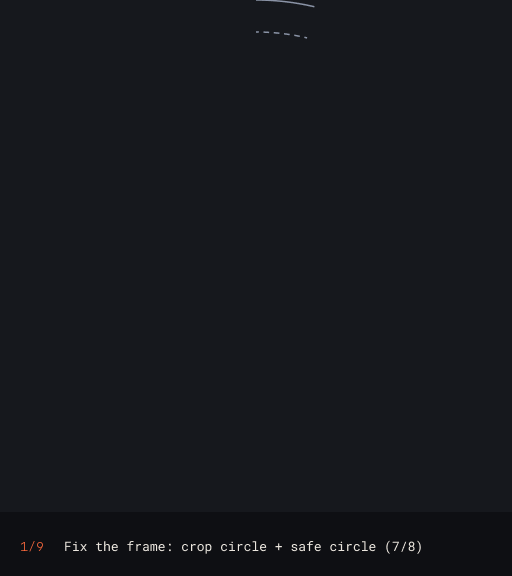
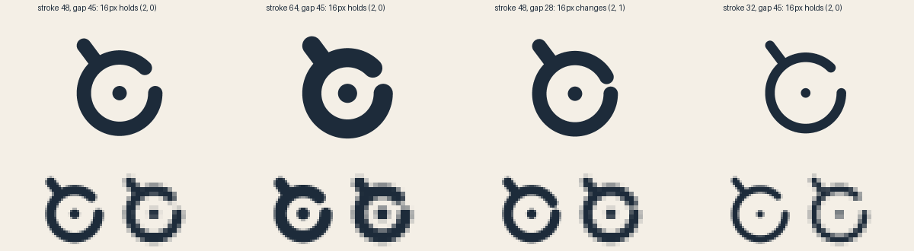
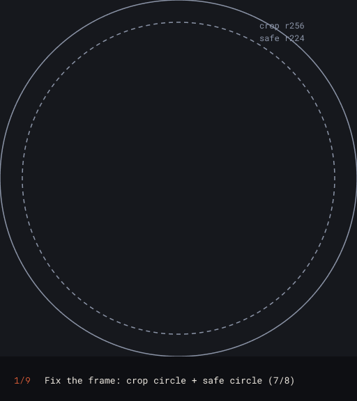
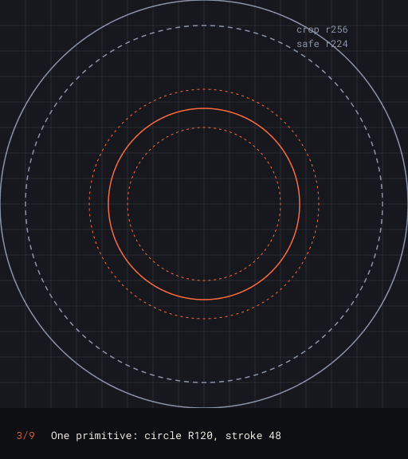
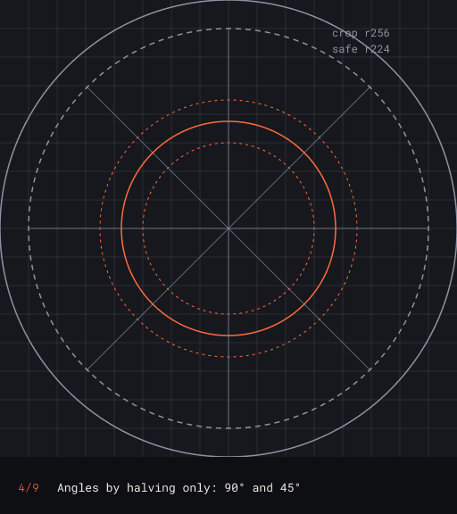
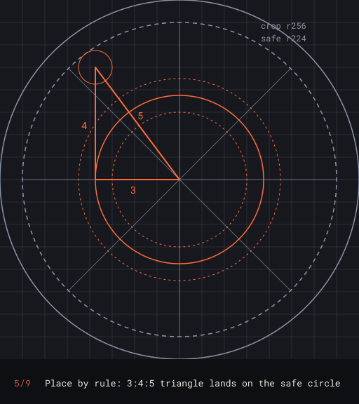
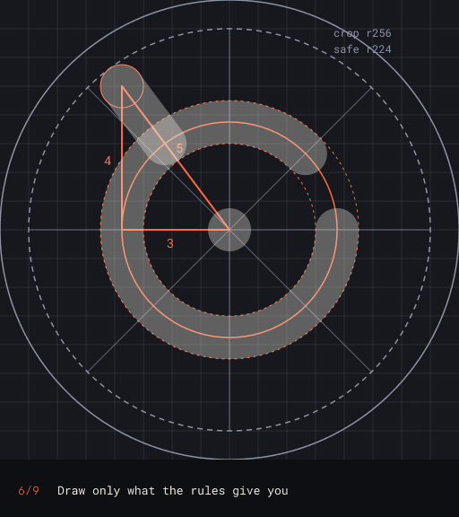
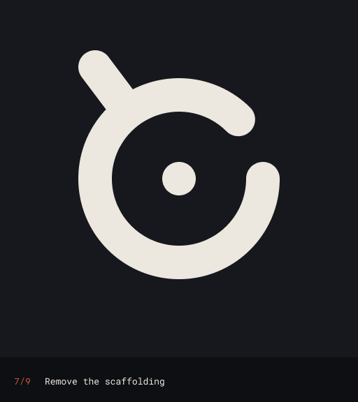
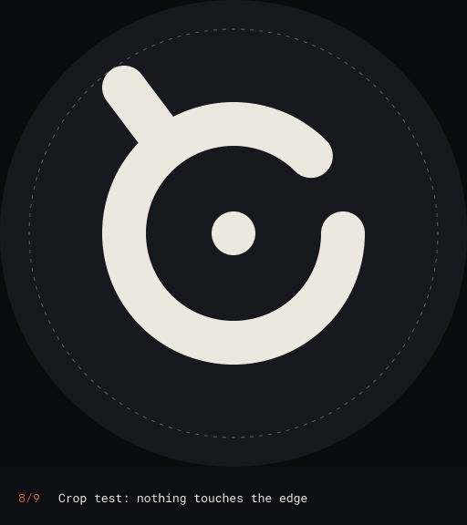
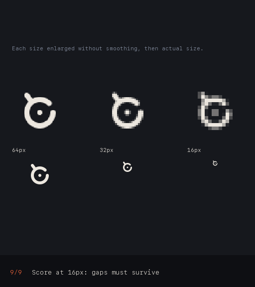

# Geometric Logo Blueprint

A Claude skill that designs and revises logo marks on a geometric blueprint: a short list of rules that rebuilds the mark exactly, from a blank canvas, without measuring.

Most "logo grids" are drawn after the logo is finished. Golden-ratio circles laid over a mark look aligned and prove nothing. This skill works the other way round. The concept comes first. Then every element gets placed by a rule simple enough to rebuild with a compass and a ruler. Then each candidate is tested where logos actually fail: a circular avatar crop and a 16px favicon.

Inspired by logo designers who build marks from simple geometry, including James Barnard's writing on logo blueprints and the constructed identities of Chermayeff & Geismar & Haviv and Bruce Blackburn. Version 2 also draws on three open projects:
- the [logo-design skill](https://github.com/kaankiziltug/logo-design-skill) by Kaan Kızıltuğ;
- the icon conventions of [Simple Icons](https://github.com/simple-icons/simple-icons);
- [Inkloom](https://github.com/Inkloom-art/inkloom)'s account of building marks under construction rules.

---

## New in v2

- **Brief to constraints.** Adjectives, audience and competitors become concrete parameters before any drawing: stroke weight, proportion, geometry family, counter shape and terminal style. The category's clichés get listed, so you can avoid them.
- **A variation tournament.** 12 to 15 one-line concepts across at least three mark types are built from rules. Two gates (crop and letter test) rule some out. Three finalists from different directions get reiterated, and then one final. Every round is kept, because a reiteration can make a mark worse.
- **Measured tests.** The kit counts ink shapes and enclosed holes at 512, 32 and 16px, so "the gap closes at favicon size" is a number, not an opinion. The battery also covers mirror, rotation and squint for unintended readings, one-colour and reversed versions, backgrounds, and a shelf test against the category.
- **Optics as numbers.** Mass sits on the optical centre. Overshoot is 1 to 3% on curves and 3 to 6% on points. The reversed file is thinned 2 to 5% for irradiation. Diagonal strokes are measured square to the stroke.
- **Production files.** Outlined arcs instead of hundreds of polyline points, one path, and a `<title>`. A 24×24 single-path monochrome icon in the Simple Icons format. A tight favicon crop. Clear space taken from the mark's own geometry.
- **`scripts/blueprint_kit.py`.** Build primitives, centre the mass, fit the safe circle, write SVGs and measure.

*The kit's demo, a generic mark made for this README. Narrowing the ring's gap from 45° to 28° looks fine at 512. The measurement shows it closing into a ring at 16px, which adds a hole.*

## What it does

- Reads the concept first, and reverse-engineers an existing mark's geometry from real file data before changing anything
- Fixes the frame: crop circle, safe circle at 7/8, module and grid
- Builds from one primitive and halved angles, and places each element with a one-line rule
- Runs a rebuild test: if any element needs a measurement, the rule gets rewritten
- Produces positive and reversed colourways and checks their contrast
- Scores candidates for scalability at 64, 32 and 16px, with a weighted scorecard and a separate favicon crop
- Delivers the master, the blueprint diagram, the crop test, the rule list and a short rationale

## The process

The demo mark below is a generic example made for this README.

| | |
| --- | --- |
|  **1. Fix the frame.** Crop circle and a safe circle at 7/8. Centre everything on the crop. |  **3. One primitive.** A single circle, one stroke weight. Grid on an 8px unit. |
|  **4. Halved angles.** 90° and 45° only. Anyone with a compass can find them. |  **5. Place by rule.** A 3:4:5 triangle puts the tail's cap exactly on the safe circle. |
|  **6. Draw what the rules give you.** Nothing placed by eye. |  **7. Remove the scaffolding.** The mark stands on its own. |
|  **8. Crop test.** Nothing touches the edge of the avatar circle. |  **9. Score at 16px.** Real exports, enlarged without smoothing. Gaps must survive. |

The animation shows the v1 construction steps; v2 adds the tournament and the measured tests on top. The frames are generated by [`examples/source/process_frames.py`](examples/source/process_frames.py). Arcs grow by angle and lines grow by length, so any SVG renderer draws them the same way.

## The scorecard

Two gates come first. Failing either one rules a candidate out, whatever its total:
- **Crop:** all ink sits inside the safe circle.
- **Letter test:** every letter still reads as itself.

Then each candidate is scored out of 50:

| Criterion | Weight |
| --- | --- |
| Favicon read: does the silhouette still say what it means at 16px? | ×3 |
| Shapes and gaps: measured counts hold at 32 and 16px | ×2 |
| Brief fit: keeps the elements that carry meaning | ×2 |
| Distinction: shelf and familiarity tests | ×2 |
| Craft and rebuild: one weight, one terminal style, optics as numbers, short rules | ×1 |

The highest total on size alone doesn't automatically win. A version that scales well only because it dropped the elements carrying the brand's meaning hasn't survived. The skill says so when it recommends.

---

## Requirements

| Requirement | Needed? | Notes |
| --- | --- | --- |
| Claude with Skills | **Required** | Claude Free, Pro, Max, Team and Enterprise, Claude Code, or the API with code execution. See [Use skills in Claude](https://support.claude.com/en/articles/12512180-use-skills-in-claude). |
| Code execution | **Required** | The geometry, SVGs and scorecard measurements are computed in Python. `scripts/blueprint_kit.py` needs `shapely`, `numpy` and `pillow` (`pip install shapely numpy pillow`). |
| Figma connection | Optional | Used to read an existing mark's real geometry and to place new frames beside the original. Without one, the skill works in SVG. |

## Install

**Claude (web, desktop, mobile)**
1. Click **Code > Download ZIP** on this page and unzip it.
2. Zip just the `geometric-logo-blueprint` folder.
3. In Claude, open **Customize > Skills**, then **+ > Create skill > Upload a skill**, and choose that ZIP.
4. Make sure the skill is toggled on.

**Claude Code**
Copy the `geometric-logo-blueprint` folder into `~/.claude/skills/`.

## Use it

- "Build a geometric blueprint for this logo concept."
- "Rebuild our mark so it doesn't get cut in a circular avatar crop."
- "Score these three logo options down to favicon size and recommend one."
- "Make the construction diagram for our brand guidelines."
- "Explore 15 variations of our mark, shortlist three and take one to final."
- "Export our symbol as a 24px single-path icon."

## Licence

MIT
